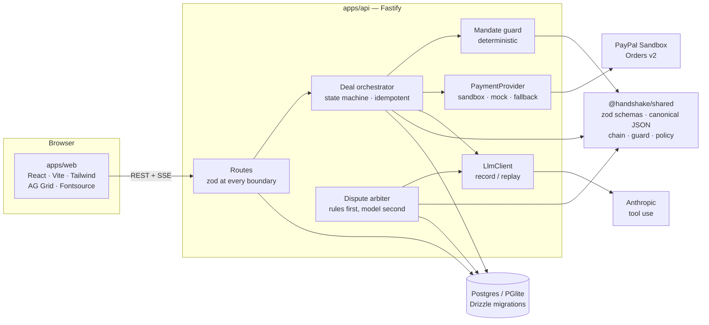
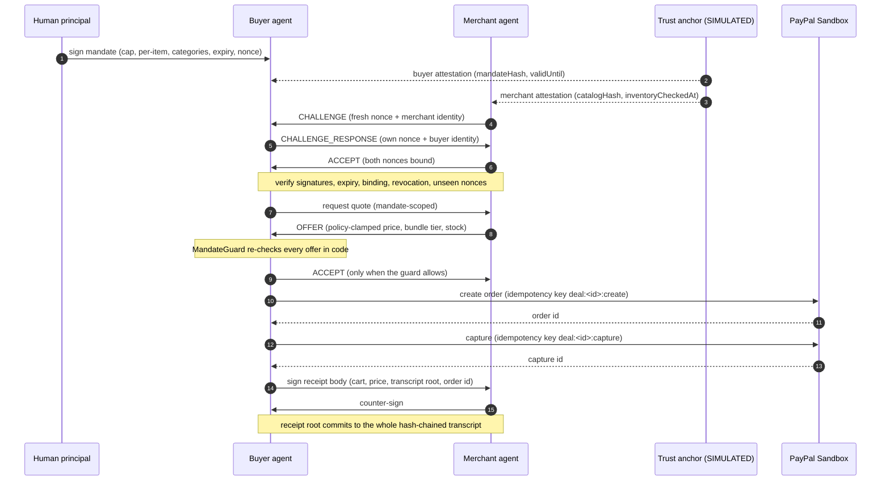

# Handshake

**An open trust layer for agent-to-agent commerce.** A human signs a spending
mandate. A buyer agent and a merchant agent prove who they are in a signed
handshake, negotiate inside policy the merchant enforces in code, settle through
the PayPal Sandbox, and both sign a receipt that commits to the whole
conversation. When a deal goes wrong, an arbiter reads that evidence packet instead
of anybody's summary of it — and decides liability deterministically before a model
is allowed to say anything at all.

Built for the **PayPal AI Hackathon 2026**.

---

## Why this needs to exist

Agents can already search, negotiate and pay. What is missing is the part a
business actually needs before it lets an agent spend money:

- **Authority you can verify.** Not a prompt that says "stay under $60" — a signed
  envelope whose limits are re-checked in deterministic code on every offer.
- **A counterparty you can identify.** A handshake with mutual attestations, fresh
  nonces and binding to the exact mandate and catalog.
- **A record both sides can check.** An append-only hash chain, a dual-signed
  receipt and a verifier that names the first byte that changed.
- **A dispute story that holds up.** Deterministic rules decide liability; a model
  may only explain an ambiguity, and its answer is thrown away if it cites evidence
  that is not in the packet.

## Screens

| Route | What it shows |
|-------|---------------|
| `/` | Runtime state, one-click Case A / Case B / reset, deals, ledger, trust |
| `/mandate` | Signed mandates with live budget meters |
| `/mandate/new` | Mandate builder with the canonical signing payload |
| `/deals/:id` | Buyer vs merchant split chat, handshake checks, guard decisions inline, payment, receipt with **Verify in browser** |
| `/disputes` | Dispute court: Case A and Case B side by side, liability meters, drafted responses |
| `/ledger` | AG Grid ledger with filtering and segmentation, plus a **tamper** control that names the broken entry |
| `/trust` | Trust scoreboard with the exact formula and its inputs |
| `/demo/script` | Three-minute narration beats with a progress marker for recording |

## Five-command setup

```bash
cp .env.example .env
pnpm install
docker compose up -d          # optional; without it the API uses embedded Postgres (PGlite)
pnpm dev                      # API :8787, web :5173
pnpm demo:reset               # build the two seeded cases
```

Open <http://localhost:5173>. No credentials are needed: without a PayPal client id
the API uses the labelled mock adapter, and without an Anthropic key the agents run
the labelled scripted negotiator. Nothing is hidden — the shell shows which mode is
live, and `GET /health` reports the same.

## Running the two cases

**From the UI.** The overview has `Run Case A`, `Run Case B` and `Reset demo data`.
Each run is a fresh deal: handshake → negotiation → PayPal capture → dual-signed
receipt → dispute → ruling.

- **Case A — a valid purchase whose claim fails.** The buyer agent buys nitrile
  gloves and N95 masks inside a $600 mandate. Delivery is recorded. The buyer then
  claims goods never arrived; the deterministic checks defeat the claim:
  `VALID_PURCHASE`, no refund.
- **Case B — a misconfigured agent.** A $20 lifetime mandate, but the deal runs with
  the MandateGuard deliberately bypassed. The agent captures above the cap; the
  bypass is written to the transcript as `DEMO-BYPASS-00` and badged on the page.
  The arbiter rules `BUYER_AGENT_OUT_OF_MANDATE` and refunds the merchant in full.

**From the CLI.**

```bash
pnpm demo:seed     # create both cases if the database is empty
pnpm demo:reset    # wipe generated evidence, then rebuild both cases
```

## PayPal Sandbox

Set these in `.env` (values are placeholders — use your own sandbox app):

```dotenv
PAYPAL_MODE=sandbox
PAYPAL_CLIENT_ID=<your sandbox REST app client id>
PAYPAL_CLIENT_SECRET=<your sandbox REST app secret>
PAYPAL_API_BASE=https://api-m.sandbox.paypal.com
PAYPAL_WEBHOOK_ID=<webhook id, if you configured a listener>
```

Then prove the credential works before trusting the UI:

```bash
pnpm paypal:smoke
```

It creates and captures a sandbox order and prints the order id, capture id and
amount as PayPal returned them. Sandbox test accounts are created in your own
PayPal developer dashboard; this repository ships no accounts, no ids and no
secrets. See [`docs/paypal-sandbox.md`](docs/paypal-sandbox.md) for exactly what was
exercised and what was not.

If the sandbox is unreachable when a new order is created, the API falls back to
the mock adapter for new orders and the shell shows **“PayPal mock fallback”**. A
capture that fails after PayPal already holds the order is reported as a failure —
it is never re-labelled as a mock success.

## What is simulated

Labelled in code, in the UI, and here.

| Component | Status |
|-----------|--------|
| Mandate, handshake and receipt signatures | **Real** Ed25519 over canonical JSON |
| Evidence hash chain | **Real** SHA-256 chained entries, verified in tests and in the browser |
| Editor/principal identity, trust anchor, attestations | **SIMULATED** — a local anchor, not PayPal identity or KYC |
| Agent identities | **SIMULATED** — keypairs stored in the local database |
| Merchant catalog (30 products) | **SIMULATED** fixture; Channel3 is not integrated (`docs/channel3.md`) |
| Negotiation dialogue | Anthropic when a key is set, otherwise a **SIMULATED** scripted negotiator |
| Payments | PayPal Sandbox when credentials are set, otherwise a **SIMULATED** mock |
| Fulfilment record | **SIMULATED** carrier + tracking number |
| Liability rulings | **Real** deterministic rules; the model only narrates ambiguity |

Full threat model: [`SECURITY.md`](SECURITY.md).

## Architecture



## The handshake, in order



## Stack

- **TypeScript** everywhere, strict, `noUncheckedIndexedAccess`.
- **pnpm** workspace: `apps/web`, `apps/api`, `packages/shared`.
- **API:** Fastify, zod, pino, Drizzle ORM, Postgres (or embedded PGlite for zero-setup).
- **Web:** React 19, Vite, Tailwind v4, AG Grid Community, Fontsource (Inter + JetBrains Mono).
- **Agents:** Anthropic TypeScript SDK, single-shot tool use with local schema validation.
- **Tests:** Vitest (unit + pipeline), Playwright (Case A / Case B end to end).

## Tools and where they are used

| Tool | Where | Honest note |
|------|-------|-------------|
| **PayPal Orders v2 Sandbox** | `apps/api/src/paypal/sandbox.ts` | OAuth token caching, `PayPal-Request-Id` idempotency, decimal-string amounts, retries only on 5xx/network/timeout, webhook signature verification when `PAYPAL_WEBHOOK_ID` is set. |
| **PayPal Disputes API** | `apps/api/src/paypal/sandbox.ts` | Implemented against the documented endpoints but not exercised in sandbox. The product's own dispute court is the demo path. |
| **Anthropic Claude** | `apps/api/src/agents/*`, `apps/api/src/arbiter/*` | Merchant phrasing and arbiter narration. Never authoritative: policy, guard and liability rules are deterministic. |
| **AG Grid Community** | `apps/web` | Ledger, deal and trust tables, with filtering. |
| **Fontsource** | `apps/web` | Inter Variable + JetBrains Mono Variable, self-hosted. |
| **Channel3** | `apps/api/src/catalog/channel3.ts` | **Not integrated.** No endpoint was invented; the adapter refuses to run without a verified contract. |
| **Docker Compose** | `docker-compose.yml` | Local Postgres. Optional. |

## Repository layout

```
apps/api        Fastify API: routes, orchestrator, agents, arbiter, PayPal adapters
apps/web        React app: overview, builder, deal, court, ledger, trust, demo script
packages/shared zod schemas, canonical JSON, chain, mandate guard, merchant policy
docs            architecture, PayPal sandbox notes, Channel3 notes, submission assets
e2e             Playwright Case A / Case B specs
```

## Testing

```bash
pnpm -r typecheck
pnpm lint
pnpm test          # shared + API unit and pipeline tests
pnpm test:e2e      # Playwright: installs a dedicated PGlite dir, runs both cases
```

The e2e suite resets demo data first, then asserts Case A reaches a verifiable
receipt, Case B records `DEMO-BYPASS-00` and is ruled `BUYER_AGENT_OUT_OF_MANDATE`,
and the ledger tamper control names the exact broken entry.

## Docs

- [`docs/ARCHITECTURE.md`](docs/ARCHITECTURE.md) — modules, state machine, invariants.
- [`SECURITY.md`](SECURITY.md) — threat model and what is simulated.
- [`docs/paypal-sandbox.md`](docs/paypal-sandbox.md) — what was exercised in sandbox.
- [`docs/channel3.md`](docs/channel3.md) — why the catalog adapter is not wired.
- [`docs/DEVPOST.md`](docs/DEVPOST.md) — submission description.
- [`docs/DEMO_SCRIPT.md`](docs/DEMO_SCRIPT.md) — shot-by-shot 3:00 video script.
- [`docs/SUBMISSION.md`](docs/SUBMISSION.md) — titles, pitches, judge testing.

## License

MIT — see [LICENSE](LICENSE).
