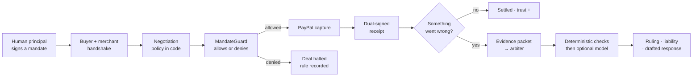
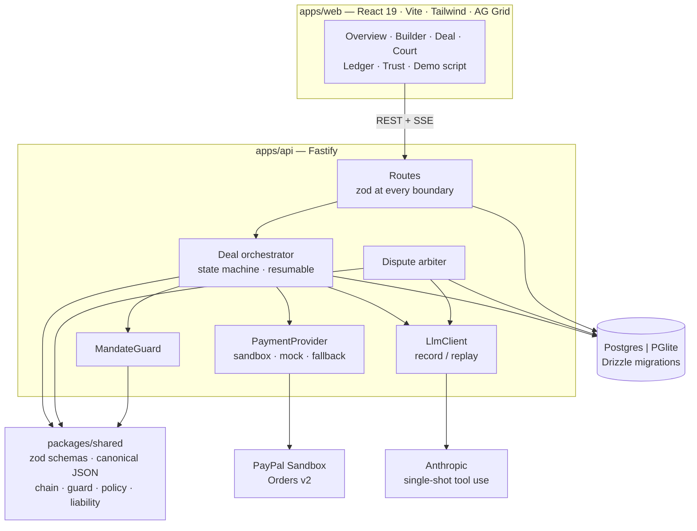
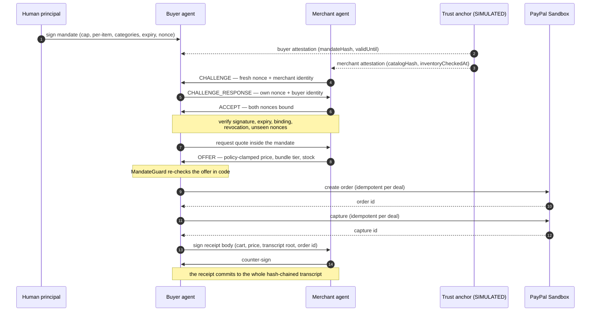

<div align="center">


# Handshake

**A signed trust layer for agent-to-agent commerce.**

A human signs a spending mandate. Two agents prove who they are, negotiate inside
policy enforced in code, settle through the PayPal Sandbox, and both sign a receipt
either side can verify — without trusting the other.

<br />

<a href="https://github.com/RHarshith2005/paypal/actions/workflows/ci.yml"></a>
<a href="https://github.com/RHarshith2005/paypal/actions/workflows/e2e.yml"></a>


<sub>Built for the <strong>PayPal AI Hackathon 2026</strong> · MIT · no credentials required to run</sub>

<br />
<br />

[Quick start](#quick-start) · [The demo](#the-demo) · [How it works](#how-it-works) · [Architecture](#architecture) · [Screens](#screens) · [Testing](#testing) · [What is simulated](#what-is-simulated)

</div>

---

> **The question this project answers**
> If two agents struck a deal and nobody was watching, what would you accept as proof?
> Handshake's answer: a mandate a human signed, a nonce-bound handshake, a real
> sandbox capture, and a hash-chained receipt both sides signed. When a dispute
> arrives, the arbiter reads that packet — not anybody's summary of it.

Agents can already search, negotiate and pay. What is missing is the part a business
needs before it lets one spend money: **verifiable authority**, **verifiable
identity**, and **evidence that survives a disagreement**.

Handshake is that layer. Its governing rule is simple:

<div align="center">

### The model proposes. Deterministic code disposes.

</div>

Every decision that matters — mandate limits, the merchant's margin floor, handshake
validity, who bears the loss — is made by ordinary TypeScript that a model cannot
argue with. The model only chooses words inside what those functions allow.

---

## At a glance

|                     |                                                                                     |
| ------------------- | ----------------------------------------------------------------------------------- |
| **Mandate checks**  | 9 ordered rules, first failure blocks the purchase                                  |
| **Handshake**       | 15 named checks — signature, expiry, binding, revocation, nonce reuse               |
| **Merchant policy** | Margin floor + discount cap + bundle tiers + stock, enforced after the model speaks |
| **Liability**       | Ordered rules `L-001 … L-011`, decided before any model call                        |
| **Evidence**        | Ed25519 signatures + SHA-256 hash chain, verified in tests _and_ in the browser     |
| **Payments**        | PayPal Orders v2 Sandbox, idempotency keys, typed errors, visible mock fallback     |
| **Tests**           | 144 unit and pipeline tests + 3 Playwright end-to-end runs                          |

---

## Quick start

```bash
cp .env.example .env          # placeholders only; no secrets anywhere
pnpm install
docker compose up -d          # optional — without it the API uses embedded Postgres (PGlite)
pnpm dev                      # API :8787 · web :5173
pnpm demo:reset               # build the two seeded cases
```

Open **<http://localhost:5173>** and you are in. Nothing is hidden: the sidebar
reports the live mode (`PayPal mock`, `Scripted`, `db:pglite`) and `/health` says the
same thing.

<details>
<summary><strong>What you need, and what you do not</strong></summary>

<br />

- **Node 22+** and **pnpm 10**.
- **No PayPal credentials** — the labelled mock adapter is used instead.
- **No Anthropic key** — the labelled scripted negotiator is used instead.
- **No database server** — embedded PGlite writes to `.data/pglite`.
- Docker is only for people who prefer Postgres locally.

</details>

---

## The demo

Two cases ship seeded, and both run through the real pipeline: handshake →
negotiation → guard → PayPal → dual-signed receipt → dispute → ruling.

<table>
<tr>
<th width="50%">Case A — a valid purchase</th>
<th width="50%">Case B — a misconfigured agent</th>
</tr>
<tr valign="top">
<td>

A $600 PPE mandate. The buyer agent purchases nitrile gloves and N95 masks inside
every limit. Delivery is recorded.

The buyer then claims the goods never arrived. The delivery record defeats the claim.

**`VALID_PURCHASE`** · liability `BUYER` · refund `0.00`

</td>
<td>

A $20 lifetime mandate, and the deal runs with the **MandateGuard deliberately
bypassed**. `DEMO-BYPASS-00` is written into the signed transcript _before_ the
capture, which lands above the signed cap.

The arbiter rules against the agent, not the merchant.

**`BUYER_AGENT_OUT_OF_MANDATE`** · full refund

</td>
</tr>
</table>

```bash
pnpm demo:seed     # create both cases if the database is empty
pnpm demo:reset    # wipe generated evidence, then rebuild both
pnpm test:e2e      # drive both cases through the real UI
```

---

## How it works



<details>
<summary><strong>1 · The mandate</strong> — authority as data, not prose</summary>

<br />

A signed envelope: lifetime cap, per-item cap, allowed categories, forbidden
substitutions, merchant allowlist, transaction count, expiry, single-use nonce.

`evaluateMandate()` runs nine checks in a fixed order and returns the rule that
decided the outcome. A denial happens **before** any state change, and the decision —
with its rule id — is written to the transcript.

</details>

<details>
<summary><strong>2 · The handshake</strong> — both sides prove legitimacy</summary>

<br />

A trust anchor (**SIMULATED**) issues short-lived attestations bound to the mandate
hash and the catalog hash. Both sides exchange a fresh nonce pair and verify
signature, expiry, agent/key binding, revocation, inventory freshness and nonce
reuse. Fifteen named checks, all recorded — passing or not.

</details>

<details>
<summary><strong>3 · Negotiation</strong> — the model talks, the policy prices</summary>

<br />

The merchant model phrases an offer; `quoteFromMove()` decides the minimum price,
clamps the requested discount, applies bundle tiers and checks stock. The buyer model
phrases a reply; the guard decides whether it may spend. Merchant text is wrapped in
delimiters it cannot close and scanned for injection — and even a successful
injection still cannot exceed the mandate.

</details>

<details>
<summary><strong>4 · Settlement</strong> — resumable, idempotent, honest</summary>

<br />

A ledger reservation is written before the PayPal order exists, so two deals cannot
overdraw one mandate. Both money movements carry `PayPal-Request-Id` values derived
from the deal id; the receipt is unique per deal. A crashed run resumes at the first
unfinished step instead of starting over.

If the sandbox is unreachable when an order is created, the labelled mock takes over
and the shell says **“PayPal mock fallback”**. A capture that fails after PayPal
already holds the order is reported as a failure — it is never relabelled a mock
success.

</details>

<details>
<summary><strong>5 · Dispute</strong> — rules first, model second</summary>

<br />

Deterministic checks run before any model: signatures, chain integrity, mandate
compliance, capture vs agreed price, receipt vs delivered items. Only a genuinely
ambiguous packet reaches the model, whose JSON must satisfy a schema **and** cite only
evidence ids that exist in the packet. Otherwise the deterministic ruling stands and
the rejected output is shown, not hidden.

</details>

---

## Architecture



### The handshake, in order



---

## Screens

| Route          | What it proves                                                                                             |
| :------------- | :--------------------------------------------------------------------------------------------------------- |
| `/`            | Runtime mode, one-click Case A / Case B / reset, deals, ledger, trust                                      |
| `/mandate`     | Signed mandates with live budget meters and enforcement history                                            |
| `/mandate/new` | Builder with the exact canonical JSON that gets signed                                                     |
| `/deals/:id`   | Buyer vs merchant split chat · handshake checks · guard decisions inline · payment · **Verify in browser** |
| `/disputes`    | Court: Case A and Case B side by side, liability meters, drafted responses                                 |
| `/ledger`      | AG Grid with filters and segmentation, plus a **tamper** control that names the broken entry               |
| `/trust`       | Scoreboard that prints the formula and the events behind every score                                       |
| `/demo/script` | Eight narration beats with a progress marker for recording                                                 |

---

## Verification you can perform

<table>
<tr><td width="34%"><strong>Verify in browser</strong></td><td>Recomputes the hash chain and the receipt digest from the bytes on screen. No server call, so the result holds offline.</td></tr>
<tr><td><strong>Tamper control</strong></td><td>Flips one byte in local memory and names the exact entry and the mismatch. Stored evidence is untouched; <em>Restore</em> puts it back.</td></tr>
<tr><td><strong>Rule ids everywhere</strong></td><td>Every allow, denial, bypass and ruling carries a stable id (<code>M-OK-00</code>, <code>DEMO-BYPASS-00</code>, <code>L-009-DELIVERY-PROVEN</code>) so a reviewer can trace the decision.</td></tr>
<tr><td><strong>Modes in the open</strong></td><td>Provider, simulation flags and model mode appear in the UI, in every deal row, in <code>/health</code> and in the README.</td></tr>
</table>

---

## Testing

```bash
pnpm -r typecheck     # strict TypeScript across shared, API, web
pnpm lint             # ESLint, zero warnings
pnpm test             # 144 unit + pipeline tests
pnpm test:e2e         # Playwright: Case A, Case B, ledger tamper
```

| Suite             | Covers                                                                                                                                                 |
| :---------------- | :----------------------------------------------------------------------------------------------------------------------------------------------------- |
| `packages/shared` | chain tampering, reordering, nonce replay, expired mandates, wrong signer, margin-floor sweeps, injection, liability rules, state machine, trust maths |
| `apps/api`        | the full pipeline, guard denial, payment failure, revoked merchant, both seeded verdicts, PayPal adapter contracts, env loading                        |
| `e2e`             | Case A to a browser-verified receipt · Case B to `DEMO-BYPASS-00` and both court verdicts · ledger tamper names `#0`                                   |

The e2e suite runs against a dedicated PGlite directory, resets state first, and needs
no credentials: mock payments and the scripted negotiator throughout.

---

## PayPal Sandbox

Set these in `.env` — placeholders only, use your own sandbox app:

```dotenv
PAYPAL_MODE=sandbox
PAYPAL_CLIENT_ID=<your sandbox REST app client id>
PAYPAL_CLIENT_SECRET=<your sandbox REST app secret>
PAYPAL_API_BASE=https://api-m.sandbox.paypal.com
PAYPAL_WEBHOOK_ID=<webhook id, if you configured a listener>
```

Prove the credential before trusting the UI:

```bash
pnpm paypal:smoke
```

It creates and captures a sandbox order and prints the order id, capture id and amount
exactly as PayPal returned them.

> **Honest status.** The Orders v2 adapter (token caching, idempotency, decimal-string
> amounts, typed errors, retries only on 5xx/network/timeout, webhook verification) is
> written against the documented endpoints but **was not exercised in this sandbox** —
> no credentials were available here. [`docs/paypal-sandbox.md`](docs/paypal-sandbox.md)
> records precisely what was and was not verified. Dispute **listing** is implemented
> against the documented API; the product's own dispute court is the demo path.

---

## What is simulated

Labelled in code, in the UI, and here.

| Component                                      | Status                                                                   |
| :--------------------------------------------- | :----------------------------------------------------------------------- |
| Mandate, handshake and receipt signatures      | **Real** — Ed25519 over canonical JSON                                   |
| Evidence hash chain                            | **Real** — SHA-256 chained entries, verified in tests and the browser    |
| Principal identity, trust anchor, attestations | **SIMULATED** — a local anchor, not PayPal identity or KYC               |
| Agent identities                               | **SIMULATED** — keypairs in the local database                           |
| Merchant catalog (30 products)                 | **SIMULATED** fixture — Channel3 is not integrated                       |
| Negotiation dialogue                           | Anthropic when a key is set, otherwise **SIMULATED** scripted negotiator |
| Payments                                       | PayPal Sandbox with credentials, otherwise **SIMULATED** mock            |
| Fulfilment record                              | **SIMULATED** carrier and tracking number                                |
| Liability rulings                              | **Real** deterministic rules — the model only narrates ambiguity         |

Full threat model: [`SECURITY.md`](SECURITY.md).

---

## Stack

<table>
<tr><td><strong>Language</strong></td><td>TypeScript, strict, on Node 22+</td></tr>
<tr><td><strong>Workspace</strong></td><td>pnpm monorepo — <code>apps/web</code> · <code>apps/api</code> · <code>packages/shared</code></td></tr>
<tr><td><strong>API</strong></td><td>Fastify · zod · pino · Drizzle ORM · Postgres or PGlite</td></tr>
<tr><td><strong>Web</strong></td><td>React 19 · Vite · Tailwind v4 · AG Grid Community · Fontsource (Inter + JetBrains Mono)</td></tr>
<tr><td><strong>Agents</strong></td><td>Anthropic TypeScript SDK · single-shot tool use · local schema validation</td></tr>
<tr><td><strong>Crypto</strong></td><td>Node Ed25519 · <code>@noble/hashes</code> for in-browser SHA-256 · canonical JSON</td></tr>
<tr><td><strong>Tests</strong></td><td>Vitest (shared + pipeline) · Playwright (Case A / Case B)</td></tr>
</table>

### Tools and where they are used

| Tool                         | Where                                             | Note                                                                  |
| :--------------------------- | :------------------------------------------------ | :-------------------------------------------------------------------- |
| **PayPal Orders v2 Sandbox** | `apps/api/src/paypal/sandbox.ts`                  | `PayPal-Request-Id` idempotency, retries only on 5xx/network/timeout  |
| **PayPal Disputes API**      | `apps/api/src/paypal/sandbox.ts`                  | Implemented, not exercised in sandbox                                 |
| **Anthropic Claude**         | `apps/api/src/agents/*`, `apps/api/src/arbiter/*` | Phrasing and narration, never authority                               |
| **AG Grid Community**        | `apps/web`                                        | Ledger, deal and trust tables with filtering                          |
| **Fontsource**               | `apps/web`                                        | Self-hosted Inter Variable + JetBrains Mono Variable                  |
| **Channel3**                 | `apps/api/src/catalog/channel3.ts`                | **Not integrated** — no endpoint invented ([notes](docs/channel3.md)) |

---

## Repository layout

```text
handshake/
├── apps/
│   ├── api/          Fastify: routes, orchestrator, agents, arbiter, PayPal adapters
│   └── web/          React: overview, builder, deal, court, ledger, trust, demo script
├── packages/
│   └── shared/       zod schemas, canonical JSON, chain, guard, policy, liability
├── docs/             architecture · sandbox notes · submission assets
├── e2e/              Playwright: Case A, Case B, ledger tamper
├── render.yaml       static web + API + Postgres blueprint
└── SECURITY.md       threat model and simulated-vs-real table
```

---

## Docs

|                                          |                                                               |
| :--------------------------------------- | :------------------------------------------------------------ |
| [Architecture](docs/ARCHITECTURE.md)     | Modules, deal state machine, invariants, failure behaviour    |
| [Security](SECURITY.md)                  | 12 threats with controls, authorisation gaps, simulated table |
| [PayPal sandbox](docs/paypal-sandbox.md) | What was exercised, what was not                              |
| [Channel3](docs/channel3.md)             | Why the catalog adapter is not wired                          |
| [Devpost](docs/DEVPOST.md)               | Submission description                                        |
| [Demo script](docs/DEMO_SCRIPT.md)       | Shot-by-shot 3:00 video with on-screen text                   |
| [Submission assets](docs/SUBMISSION.md)  | Titles, pitches, judge testing instructions                   |

---

## Known limits

- **Single tenant.** No accounts, no per-deal authorisation. `API_WRITE_TOKEN` is the
  only write control; see `SECURITY.md`.
- **The anchor is local.** Real deployment needs a verifiable identity provider behind
  the same interface.
- **Channel3 is not wired.** The fixture catalog stands in.
- **Bundle size.** AG Grid ships whole; the web chunk is ~1.6 MB (noted, not optimised).
- **Sandbox capture unverified here** — run `pnpm paypal:smoke` with your credentials.

## What's next

Replace the simulated anchor with a real identity provider · anchor receipt roots in
an external append-only store · multi-tenant accounts with per-deal authorisation · a
policy DSL with property-based tests over price, margin and inventory.

---

<div align="center">
<br />

**MIT licensed** · see [LICENSE](LICENSE)

<sub>Handshake · a signed trust layer for agent commerce · mandate limits enforced in deterministic code</sub>

<br />
<br />

</div>
